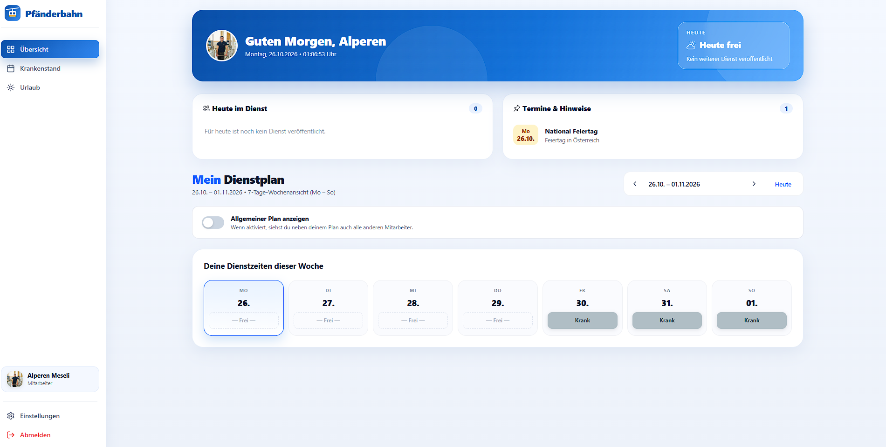

<div align="center">

# 🚡 Pfänderbahn – Digitales Mitarbeiterportal

> **Das moderne digitale Dienstplan- und Verwaltungssystem für die Mitarbeiter der Pfänderbahn.**  
> _Schluss mit Zettelwirtschaft – Dienstzeiten, Krankenstände und Urlaubsanträge digital an einem Ort._

</div>

---

## 📱 Ein Blick in das Projekt

<div align="center">
  
</div>

---

## 🌟 Features

- **Übersichtliches Dashboard:** Sofortiger Blick auf die aktuellen Dienstzeiten der Woche, den Schichtstatus und wichtige Hinweise bzw. Feiertage.
- **Digitale Krankenmeldung:** Einfaches Hochladen von Krankenzetteln (Foto oder PDF) inklusive Statusverfolgung (`Wird geprüft` / `Bestätigt`)[cite: 2].
- **Urlaubsmanagement:** Urlaubsanträge unkompliziert einreichen, den nächsten Urlaub im Blick behalten und den Status (`Genehmigt` / `Abgelehnt`) in Echtzeit verfolgen[cite: 3].
- **Kollegen-Ansicht:** Optionaler Einblick in den allgemeinen Dienstplan, um Schichten im Team besser zu koordinieren[cite: 1].

---

## 🛠️ Tech Stack

- **Frontend:** TypeScript / HTML5, CSS3 / Tailwind CSS, JavaScript
- **Datenbank:** SupaBase
- **Hosting / Deployment:** Vercel

---

## 🚀 Quick Start

Falls du das Projekt lokal ausführen möchtest:

1. **Repository klonen**
   ```bash
   git clone [https://github.com/DEin-Benutzername/pfaenderbahn-portal.git](https://github.com/DEin-Benutzername/pfaenderbahn-portal.git)
   ```
